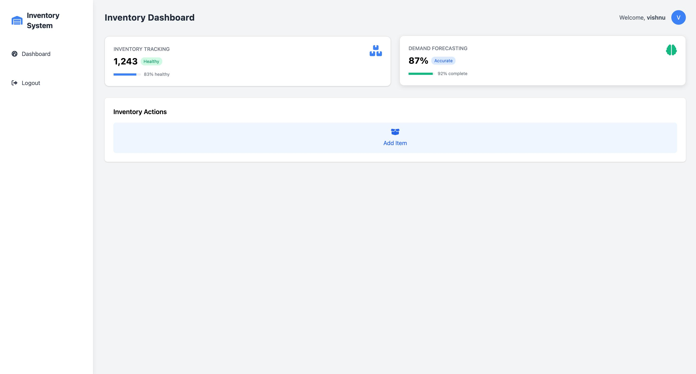
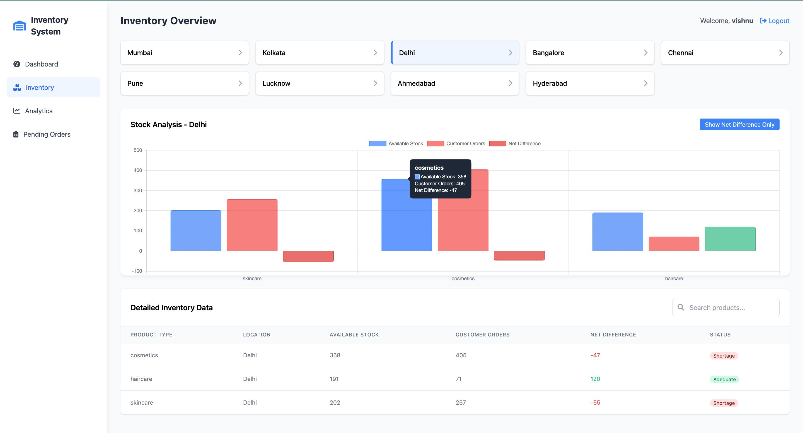
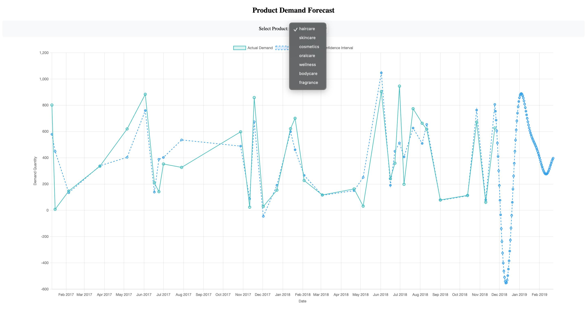
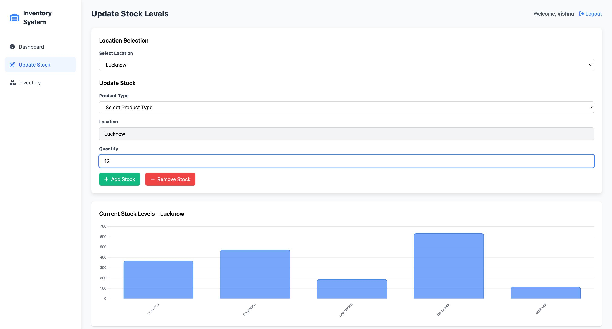

# Supply Chain Management System

A full-stack web application that streamlines inventory management and predicts product demand using machine learning. Built with **Flask, MySQL and Prophet**.

Traditional supply chains rely on manual processes and disconnected tools, which causes delays, overstocking and stockouts. This project gives a single dashboard to monitor stock across cities, update inventory, and forecast future demand.

## Features

### 1. Inventory Dashboard
- Select a city (Mumbai, Delhi, Bangalore, Chennai, Kolkata, Pune, Lucknow, Ahmedabad, Hyderabad) to view local stock
- Bar chart comparing **Available Stock vs Customer Orders** per product category
- **Net Difference** (stock minus orders) to spot shortages and surpluses
- Toggle to show Net Difference only
- Searchable data table with a **Shortage / Adequate** status label

### 2. Demand Forecasting
- Uses historical sales data from MySQL, grouped by product type
- **Prophet** model predicts demand for the next 90 days
- Interactive line chart (actual demand vs forecast with confidence interval)
- Helps plan reordering and reduce overstocking and stockouts

### 3. Update Inventory
- Choose a location and product type
- **Add or remove stock** with real-time database updates
- Bar chart of current stock levels for the selected location

### 4. Authentication
- User registration and login
- Passwords stored as hashes (Werkzeug)
- Session-based access control on all pages

## Tech Stack

| Layer | Technology |
|---|---|
| Frontend | HTML, CSS, JavaScript, Tailwind CSS, Chart.js |
| Backend | Python, Flask |
| Database | MySQL |
| Machine Learning | Prophet, Pandas |
| Other | SQLAlchemy, Plotly |

## System Architecture

```
Frontend (HTML/CSS/JS)  --HTTP-->  Backend (Flask)  -->  Database (MySQL)
                                                              |
                                                     Machine Learning
                                                    (Demand Forecasting)
```

## Screenshots

### Login


### Dashboard


### Inventory Overview


### Demand Forecast


### Update Stock


## Getting Started

### Prerequisites
- Python 3.9+
- MySQL Server

### Installation

```bash
git clone https://github.com/vishnuroopeshc/inventory-system.git
cd inventory-system
pip install -r requirements.txt
```

### Configuration

Copy the example environment file and fill in your values:

```bash
cp .env.example .env
```

```
SECRET_KEY=your-long-random-string
DB_HOST=localhost
DB_USER=your-mysql-user
DB_PASSWORD=your-mysql-password
DB_NAME=login_system
```

### Database

Create a MySQL database with these tables:

| Table | Purpose |
|---|---|
| `users` | Login credentials (username, hashed password) |
| `product_info` | Stock levels and order quantities per product type and location |
| `supply_chain_data` | Historical sales data (date, product type, units sold) used for forecasting |

### Run

```bash
python app.py
```

Open `http://127.0.0.1:5000` in your browser.

## Project Structure

```
Inventory_System/
├── app.py              # Flask app, routes, forecasting logic
├── requirements.txt
├── .env.example
├── static/             # CSS
├── templates/          # HTML pages
└── screenshots/
```

## Challenges Faced

- Connecting backend and frontend for real-time data updates
- Choosing a suitable forecasting model and handling data quality
- Building secure login with SQL and session management
- Keeping inventory data consistent when updating by location and product type

## Future Improvements

- Pending orders and analytics pages
- Supplier and order tracking
- Automatic restock alerts based on thresholds
- Forecasts per location